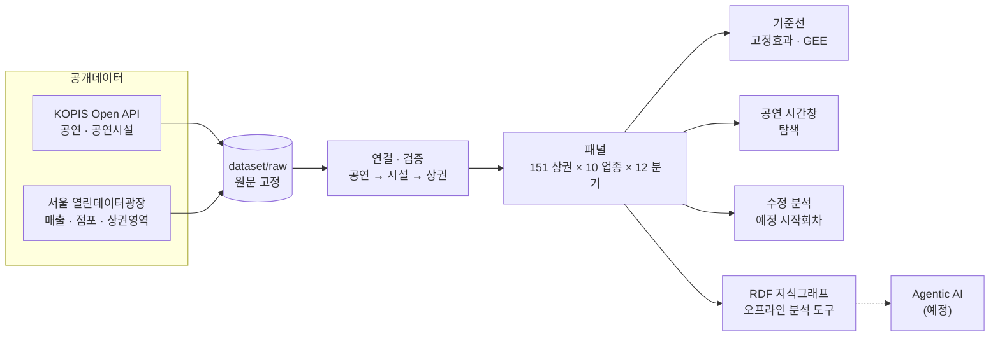

<a id="readme-top"></a>

<div align="center">

# 공연 활동과 주변 외식업 매출

**공연이 많은 분기에는 근처 음식점과 카페의 매출도 달라질까?**

서울 종로구·마포구의 공개데이터로 공연 활동과 외식업 매출의 관계를 분석하고,<br>
데이터의 의미와 결합 규칙을 이해해 그 분석을 재현하는 **온톨로지 기반 Agentic AI 서비스**를 만드는 학부 졸업프로젝트

<sub>지도교수 김태경 · 2023~2025년 분기 자료 · 외식업 10종</sub>

<br>

[](environment/README.md)
[](start-jupyter.cmd)
[](requirements.txt)
[](requirements.txt)
[](environment/setup.ps1)

[결과 보기](#주요-결과) · [실행하기](#시작하기) · [폴더 안내](#저장소-구성) · [상세 연구계획서](documents/proposals/졸업프로젝트_상세연구계획서_개정안.md)

</div>

<br>

> [!NOTE]
> **지금까지의 답** — 정해진 공개자료와 표본에서는 공연 활동과 외식업 분기 매출 사이에 **뚜렷한 관련성을 확인하지 못했다.** 효과가 없다는 증거가 아니라, 분기 단위 매출과 예정 회차라는 측정 조건 안에서 얻은 결과다. 자세한 내용은 [주요 결과](#주요-결과)에 있다.

<details>
<summary><b>목차</b></summary>

1. [한눈에 보기](#한눈에-보기)
2. [연구 소개](#연구-소개)
3. [데이터](#데이터)
4. [분석 방법](#분석-방법)
5. [주요 결과](#주요-결과)
6. [저장소 구성](#저장소-구성)
7. [시작하기](#시작하기)
8. [작업 원칙](#작업-원칙)
9. [연구의 한계](#연구의-한계)
10. [로드맵](#로드맵)
11. [참고자료](#참고자료)

</details>

---

## 한눈에 보기

| 구분 | 내용 |
|---|---|
| **질문** | 같은 상권에서 공연 활동이 평소보다 많은 분기에 외식업 매출 규모와 야간 매출도 다른가? |
| **지역** | 서울 종로구·마포구 상권 151개 (대상 구 밖이라도 상권 500m 안의 공연장은 포함) |
| **업종** | 서울시 상권 자료의 외식업 10종 전체 |
| **기간** | 2023년 1분기 ~ 2025년 4분기, 12분기 |
| **분석 단위** | 상권 × 업종 × 분기 (기본 패널 18,120행) |
| **자료** | KOPIS 공연·공연시설 Open API, 서울 열린데이터광장 추정매출·점포·상권영역 |
| **방법** | 상권×업종·업종×분기 고정효과 모형, 상권 군집 표준오차, 사전 고정 분석 계획 |
| **시스템** | RDF 온톨로지·지식그래프, 검증된 오프라인 분석 도구 5종 → 단일 에이전트(예정) |
| **진행** | 데이터셋·실증분석·진단 완료, 온톨로지 부분 구현, AI 서비스·비교 평가 준비 중 |

<p align="right"><a href="#readme-top">맨 위로 ↑</a></p>

---

## 연구 소개

### 왜 이 연구를 하나

공연을 보고 나와 근처에서 밥을 먹거나 커피를 마시는 일은 흔하다. 그렇다면 그 소비가 주변 상권의 매출에서도 보일까?

막상 확인하려고 하면 자료끼리 잘 맞지 않는다. 공연 자료(KOPIS)와 상권 자료(서울시)는 시간 단위·공간 단위·측정 단위가 서로 다르다. 그대로 연결하면 분기 자료를 월별이나 일별로 읽거나, 미제공 매출을 0원으로 채우거나, 같은 공연을 여러 상권에서 중복으로 세는 실수가 쉽게 생긴다.

그래서 이 프로젝트는 두 가지를 함께 한다. 하나는 공연과 외식업 매출의 관계를 공개데이터로 **조심스럽게 분석**하는 것이고, 다른 하나는 그런 결합 규칙을 온톨로지로 정리해 **AI가 같은 실수를 하지 않도록** 돕는 서비스를 만드는 것이다.

문제의식은 김태경 교수님이 참여한 업종 간 공간적 관계 연구(고품질 음식점과 호텔 성과)에서 가져왔다. 이 연구는 그 관점을 **공연 → 외식업**으로 넓힌 사례이며, 원 논문의 자료나 식별 전략을 재현하지는 않는다.

### 연구 질문

| 구분 | 질문 | 성격 |
|---|---|---|
| **RQ1 매출 규모** | 같은 상권에서 공연 활동이 평소보다 많은 분기에 외식업 매출도 다른가? | 핵심 실증 |
| **RQ2 매출 구성** | 야간(21~24시) 매출은 공연 활동과 어떤 관계를 보이며, 업종별로 다른가? | 핵심 확장 |
| **RQ3 서비스 성능** | 온톨로지를 쓰면 AI의 단위·기간·공간 결합 오류가 줄어드는가? | 핵심 시스템 |
| RQ4 추가 탐색 | 주말 비중, 장르, 시차, 공연 시간창에서 추가 패턴이 보이는가? | 선택 |

방향과 크기를 미리 정하지 않고 양측 검정과 신뢰구간으로 보고한다. 결과는 **관련성**으로 해석하며 인과효과로 단정하지 않는다.

### 네 단계로 만든다

| 단계 | 산출물 | 상태 |
|---|---|---|
| ① 데이터셋 구축 | 공연·공연장·상권·업종·분기별 매출을 연결한 패널 | 완료 |
| ② 온톨로지 구축 | 기간·장소·업종·측정 단위·출처·허용되는 결합 규칙을 RDF로 정의 | 부분 구현 |
| ③ Agentic AI 구축 | 자연어 질문을 개념 조회 → 자료 결합 → 통계 도구 실행 → 근거 설명으로 바꾸는 단일 에이전트 | 준비 중 |
| ④ 분석 및 평가 | 업종별 관련성 분석, 데이터 사전 기반 에이전트와 온톨로지 기반 에이전트의 오류·성공률 비교 | 분석 완료, 평가 준비 중 |

<p align="right"><a href="#readme-top">맨 위로 ↑</a></p>

---

## 데이터

### 범위

- **지역** — 서울 종로구·마포구의 상권. 대상 구 밖이라도 상권 기준 500m 안의 공연장은 포함한다.
- **업종** — 서울시 상권 자료의 외식업 10종 전체: 한식, 중식, 일식, 양식, 제과점, 패스트푸드점, 치킨전문점, 분식전문점, 호프-간이주점, 커피-음료. 처음 계획한 두 업종(한식·커피)은 기준선 검증용으로 남겼다.
- **기간** — 2023년 1분기 ~ 2025년 4분기, 12분기.
- **분석 단위** — 상권 × 업종 × 분기.

### 출처

| 자료 | 출처 | 사용 내용 |
|---|---|---|
| 추정매출-상권 | 서울 열린데이터광장 [OA-15572](https://data.seoul.go.kr/dataList/OA-15572/A/1/datasetView.do) | 분기 총매출, 6개 고정 시간대(00-06, 06-11, 11-14, 14-17, 17-21, 21-24시) 매출 |
| 점포-상권 | 서울 열린데이터광장 [OA-15577](https://data.seoul.go.kr/dataList/OA-15577/S/1/datasetView.do) | 일반·프랜차이즈·전체 점포 수 |
| 영역-상권 | 서울 열린데이터광장 [OA-15560](https://data.seoul.go.kr/dataList/OA-15560/S/1/datasetView.do) | 상권 경계 (현재 버전) |
| 공연·공연시설 | [KOPIS Open API](https://kopis.or.kr/por/main/main.do) | 공연 ID·기간·시설·공연 일정, 시설 좌표 |

### 고정한 수집 회차

| 자료 | 회차 | 담긴 내용 |
|---|---|---|
| KOPIS | `20261004_154020_1c7d3b` | 시설 상세 1,755개, 후보 공연 상세 13,727개. 서울 전체 공연 목록의 상세를 모두 수집했다는 뜻은 아니다 |
| 서울시 | `20261004_091155_b8dd0e` | 연도별 매출·점포와 현재 상권 경계 |

두 회차의 명세는 [`jupyter-notebook/20261006/metadata/`](jupyter-notebook/20261006/metadata/)에 고정했다. 이후 다시 수집하더라도 이 명세는 자동으로 바뀌지 않는다. 원문·중간표·파생 자료의 자세한 구성은 [dataset/README.md](dataset/README.md)에 있다.

<p align="right"><a href="#readme-top">맨 위로 ↑</a></p>

---

## 분석 방법

### 전체 흐름



### 1. 데이터셋 구축

1. 원본 CSV·API 응답 → 열 이름·타입 통일 → 상권·업종·분기 키 검사(일대일 결합 강제)
2. **공연 → 공연장** — 공식 시설 ID 연결과 시설명 임시 연결을 구분해 기록한다. 공식 ID 연결은 13,727건, 시설명 잠정 연결은 16,320건이며, 연구 범위 부분 그래프에는 공식 연결만 쓴다.
3. **공연장 → 상권** — 미터 단위 투영 좌표계(EPSG:5181)로 거리를 계산하고, 500m 이내 관계를 모두 연결한다. 최단 1개만 고르지 않는다.
4. 분기별로 공연 노출을 집계하고 매출·점포와 결합한다.
5. 결측을 처리하고 표본 제외 사유를 보고한다.

> [!IMPORTANT]
> **미제공 매출은 0원으로 채우지 않는다.** 실제로 0원이 제공된 값만 0으로 둔다. 분기 자료를 일별 자료로 해석하지 않는다. 일반점포가 0이고 프랜차이즈가 양수인 행은 오류가 아니다. 매출 모집단이 확인되기 전에는 점포당 매출을 만들지 않는다.

### 2. 공연 활동(노출)을 무엇으로 재나

| 지표 | 정의 | 사용 단계 |
|---|---|---|
| 등록 공연 ID 수 | 분기와 공연 기간이 겹치는 공연 ID 수 | 기준선 분석 |
| **예정 시작회차** | 등록 기간에 상세정보의 정규 요일·시각을 반복해 만든 분기 내 시작 횟수 | 수정 분석 (현재 기본) |
| 예정 시간창 노출 | 시작시각 + 러닝타임으로 추정한 종료 후 0~3시간, 3~6시간 등이 매출 시간대와 겹치는 분량 | 시간창 탐색 |

예정 시작회차는 실제 회차나 관객 수가 아니다. 휴연, 과거 일정 변경, 공휴일 특수 일정은 반영하지 못한다.

### 3. 공간 연결

- **기준선** — 공연장 점과 상권 폴리곤 사이의 최단거리가 500m 이하인 관계. 민감도 분석에는 300m와 800m를 쓴다.
- **수정 분석** — 상권 중심점에서 500m 이내인 시설을 기본으로 한다. 기존 최단거리 연결은 비교 사양으로 남겼다.
- 500m는 공연 노출을 상권에 부여하는 규칙이다. "공연장 500m 안 음식점만의 매출"을 뜻하지 않는다.

### 4. 통계 모형

$$
Y_{ast} = \alpha_{as} + \lambda_{st} + \beta_s \ln(1 + E_{at}) + \varepsilon_{ast}
$$

| 기호 | 의미 |
|---|---|
| $a, s, t$ | 상권, 업종, 분기 |
| $\alpha_{as}$ | 상권×업종 고정효과 — 상권·업종의 변하지 않는 차이 |
| $\lambda_{st}$ | 업종×분기 고정효과 — 업종별 공통 분기 변화 |
| $\beta_s$ | 업종별 공연 활동 계수 |

- **결과변수** — 기준선은 ln(총매출)과 야간 비중(%), 수정 분석은 ln(1+총매출액)과 ln(1+21~24시 매출액). 수정 분석에서 비중은 기술통계로만 쓴다.
- **추론** — 상권 군집 표준오차(CR1)와 t(G−1) 분포. 신뢰구간은 개별 95% 구간이다.
- **다중검정** — Benjamini–Hochberg(BH)와 Holm으로 보정한다. 미추정 결과는 p=1로 포함한다.
- **효과 크기** — "1+노출이 2배일 때 매출+1의 조건부 기하평균 상대차이(%)"로 표기한다.

<details>
<summary><b>보조·민감도 분석과 사전 고정 원칙</b></summary>

<br>

**보조·민감도 분석**

- 거리 300/500/800m, 균형표본, 일반점포·전체점포 통제
- within-between GEE와 고정효과 결과 비교
- 공연 시간창 모형: 6개 시간대 매출에 상권×업종×분기 고정효과를 더한 시간대 상대 패턴
- 공간 표준오차 민감도: 가우시안 커널, 대역폭 1km

**사전 고정 원칙**

- 수정 분석의 4개 사양(중심점 100%, 중심점 90%, 최단거리 100%, 같은 표본의 ID 수)은 회귀 결과를 보기 전에 [`revised_quarterly_plan.json`](jupyter-notebook/20261006/metadata/revised_quarterly_plan.json)에 고정했다.
- 시간창 분석의 창·결과변수·표본 기준도 모형 적합 전에 [`time_window_plan.json`](jupyter-notebook/20261006/metadata/time_window_plan.json)에 고정했다.
- p값에 따라 사양을 고르지 않는다. 비유의·미추정 결과, 표본 제외 사유와 다중검정 범위를 함께 보고한다.

</details>

### 5. 온톨로지와 분석 도구

- **RDF 지식그래프** ([notebooks/07](jupyter-notebook/20261006/notebooks/07_RDF_지식그래프.ipynb)) — 공연·시설·상권·업종·분기·지표의 관계와 단위·집계 규칙·출처를 RDFLib으로 표현하고 무결성을 검사한다. 큰 집계 테이블은 CSV로 두고, 그래프는 의미와 관계를 관리한다.
- **분석 도구** ([notebooks/08](jupyter-notebook/20261006/notebooks/08_분석도구.ipynb)) — 구조화된 요청으로 지표·집계·모형·품질을 조회하는 오프라인 도구 5종과 JSON 호출 계약.
- **설계 원칙** — LLM이 숫자를 직접 만들지 않고 계산은 검증된 도구가 맡는다. "공연이 매출을 증가시킨다" 같은 인과관계를 온톨로지에 사실로 넣지 않는다.

<p align="right"><a href="#readme-top">맨 위로 ↑</a></p>

---

## 주요 결과

| 단계 | 노출 · 공간 | 무엇을 봤나 | 핵심 결과 |
|---|---|---|---|
| ① 기준선 | 등록 공연 ID 수 · 최단거리 500m | 10개 업종 계수 결합검정 | 총매출 p=0.79, 야간 비중 Holm p=0.38. BH 보정 후 유의 0건 |
| ② 시간창 탐색 | 종료 후 0~3시간 등 4개 창 | 시간대별 상대 매출 패턴 | 공통 기울기 −0.040 [−0.105, +0.024]. 업종별 40개 검정 모두 보정 전 p≥0.05 |
| ③ 비유의성 진단 | 기존 64개 결과 재현 | 결과가 뚜렷하지 않은 이유 | 계산 오류는 아님(최대 차이 ≈ 2×10⁻¹⁶). 측정·변동·표본·노출 중첩의 구조적 원인 |
| ④ **수정 분석** | **예정 시작회차 · 중심점 500m** | 사전 고정 4사양 × 2결과 × 10업종 | **80개 결과 모두 보정 전 p≥0.05**. 한식 총매출 +0.32% [−2.52%, +3.24%] |
| ⑤ 보조 실험 | 사후 탐색 · 오용 시연 · 효과 주입 | 같은 자료로 p값이 달라지는 경로 | 580개 검정 중 보정 전 16개, 전체 BH 후 0개 (본 연구 미반영) |

<details>
<summary><b>① 기준선 분석 — 등록 공연 ID 수, 최단거리 500m</b></summary>

<br>

- 총매출과 야간 비중 모두에서 10개 업종 계수 전체에 대한 결합 검정이 유의하지 않았다.
  - 총매출: p=0.79
  - 야간 비중: Holm 보정 p=0.38
- 보정 전 p<0.05는 야간 비중 2건(치킨 +1.10%p, 한식 −0.39%p)이었다. BH 보정 후에는 0건이었다.

</details>

<details>
<summary><b>② 공연 시간창 탐색 — 종료 후 0~3시간 등 4개 창</b></summary>

<br>

- 종료 후 0~3시간의 공통 기울기는 −0.040, 95% CI는 [−0.105, +0.024]였다.
- 업종별 40개 검정 중 보정 전에도 유의한 결과가 없었다.

</details>

<details>
<summary><b>③ 비유의성 진단 — 무엇이 결과를 흐리게 했나</b></summary>

<br>

데이터 수집 실패나 계산 오류는 아니었다. 기존 64개 결과를 재현했고 최대 차이는 약 2×10⁻¹⁶이었다. 대신 다음과 같은 구조적 원인이 확인됐다.

- **측정이 연구 질문보다 넓다** — 분기 집계, 등록 공연 ID 수 사용, 관객 수 미관측
- **비교에 쓸 수 있는 변동이 적다** — 고정효과로 공통 변화를 제거하면 노출 변동이 줄어들고, 일부 업종은 정보가 소수 상권에 몰려 있다.
- **업종별 표본이 다르다** — 매출 미제공 여부에 따라 업종마다 관측되는 상권이 다르다.
- **노출이 겹친다** — 공연 ID의 99%가 둘 이상의 상권에 연결된다.

</details>

<details>
<summary><b>④ 수정 분석 — 예정 시작회차, 중심점 500m, 총매출액·야간 매출액</b></summary>

<br>

- 주 표본은 5,015행, 114개 상권, 10개 업종이다.
- 사전에 고정한 4개 사양 × 2개 결과 × 10개 업종, 총 80개 결과 모두 보정 전부터 p≥0.05였다.
  - 예: 한식 총매출 **+0.32% [−2.52%, +3.24%]**, 패스트푸드 총매출 **+5.18% [−3.61%, +14.77%]**
- 한식은 0에 가까운 작은 범위로 추정됐다. 패스트푸드처럼 상당한 양의 관계도 배제하지 못하는 업종도 있다.
- **대표성 제약** — 일정 가용률 100% 기준은 공연 밀집 상권을 크게 제외한다.
  - 대학로(혜화역)와 홍대입구역(홍대)은 기본 표본에서 빠졌다.
  - 분기 후보 공연이 100개 이상인 관측은 2.84%만 남았다.

</details>

<details>
<summary><b>⑤ 보조 실험 — <code>jupyter-notebook/sandbox/</code>, 본 연구에 반영하지 않음</b></summary>

<br>

- **실제자료 사후 탐색** — 580개 검정 중 보정 전 p<0.05는 16개였고, 전체 BH 보정 후에는 0개였다.
- **합성 효과 주입 모의실험** — 10개 업종에 같은 효과가 있고 공간 상관이 없다는 가정에서 계산했다. 실제 효과가 5%라면 BH 보정 후 검출률은 한식 약 87%, 커피 약 45%, 패스트푸드 약 18%다.
- 이 결과는 실제 효과의 존재 확률이 아니다. 업종별 정밀도의 차이를 보여 주는 참고자료다.

</details>

> [!TIP]
> **결론을 말하는 방식** — 유의하지 않은 결과는 "공연의 소비 효과가 없다"는 증거가 아니다. 이 결과가 말해 주는 것은 정해진 공개자료와 표본에서 **뚜렷한 분기 단위 관련성을 확인하지 못했다**는 점이다. 지표 정의, 공간 연결, 일정 가용성에 따라 표본과 결과가 달라진다는 점도 함께 연구 결과로 제시한다.

### 보고서 읽기

| 보고서 | 내용 |
|---|---|
| [수정 분석 결과](reports/20261006/revised_quarterly/report.html) | 현재 결과. 예정회차·매출액·표본 기준을 바꾼 재분석 |
| [비유의성 진단](reports/20261006/null_diagnostics/report.html) | 결과가 뚜렷하지 않은 이유 |
| [기준선 분석 보고서](reports/20261006/analysis_report/report.html) | 등록 공연 ID 수 기준선 |
| [공연 시간창 분석](reports/20261006/time_windows/공연시간창_분석보고서.html) | 종료 후 시간창과 시간대 매출 |
| [보조 실험 종합](documents/reports/유의한%20결과는%20어떻게%20만들어지는가.html) | 같은 자료로 p값이 달라지는 경로 |

처음이라면 **기준선 → 비유의성 진단 → 수정 분석** 순서로 읽기를 권한다. HTML 보고서는 GitHub 웹에서는 소스로 보이므로 저장소를 내려받아 브라우저로 연다. 알아보기 쉬운 이름의 사본이 [`documents/reports/`](documents/reports/)에 있다.

<p align="right"><a href="#readme-top">맨 위로 ↑</a></p>

---

## 저장소 구성

```text
graduation-project/
├── dataset/            원문 → 중간표 → 분석용 파생 자료
├── jupyter-notebook/   모든 분석·수집 코드 (Jupyter Notebook)
├── reports/            결과 표·그림·HTML 보고서, 수집 기록
├── documents/          연구계획서, 참고문헌, 읽기용 보고서
├── metadata/           공용 수집·이관 기록
├── environment/        재현 환경, 경로 해석, 검증 노트북
├── AGENTS.md           작업 규칙
├── requirements.txt    직접 의존성
└── start-jupyter.cmd   JupyterLab 실행
```

| 폴더 | 무엇이 있나 | 자세히 |
|---|---|---|
| **`dataset/`** | 수집 원문(`raw/`, 읽기 전용), KOPIS 중간표(`processed/`), 분석 패널과 연결표(`analysis/`). 현재 분석의 파생 자료는 `analysis/final/`에 있다 | [README](dataset/README.md) |
| **`jupyter-notebook/`** | 현재 분석 `20261006/`(분석 01~13, 보고서·진단 01~09, 수집 01~05, 고정 입력 명세), 이전 분석 보관본 `20261005/`, 독립 실험 `sandbox/` | [README](jupyter-notebook/README.md) |
| **`reports/`** | 현재 결과 `20261006/`(기준선·시간창·진단·수정 분석·자료 확보), 이전 결과 `20261005/`, KOPIS·서울시 수집 기록 | [README](reports/README.md) |
| **`documents/`** | 요약·상세 연구계획서, 참고 논문과 RDF 학습 자료, 읽기용 HTML 보고서 7편 | [README](documents/README.md) |
| **`metadata/`** | 다운로드 매니페스트, 원자료 점검 요약, KOPIS 수집 상태, 파일 이관 기록. 분석 입력 명세와는 별개다 | [README](metadata/README.md) |
| **`environment/`** | Python 3.12.14·Node 24.12.0 런타임, 오프라인 패키지 111개, 보고서 생성기, 경로 해석 노트북, 재현 검증 노트북 | [README](environment/README.md) |

루트의 [AGENTS.md](AGENTS.md)는 이 저장소의 작업 규칙이다. AI 코딩 도구도 이 파일을 읽고 따른다. `.venv/`는 설치 스크립트가 만드는 로컬 환경이라 저장소에는 없다.

<p align="right"><a href="#readme-top">맨 위로 ↑</a></p>

---

## 시작하기

### 준비물

- Windows x64 PC — 포함된 Python·Node 실행 파일이 Windows용이다.
- 넉넉한 디스크 공간 — 원자료와 실행 환경이 저장소에 함께 들어 있어 작업 폴더만 약 1.1GB다.
- 네트워크·API 인증키는 필요 없다. 분석은 고정된 로컬 입력만 읽는다.

### 설치

```powershell
# 1. 저장소 받기
git clone https://github.com/Chika1472/graduation-project.git
cd graduation-project

# 2. 프로젝트 전용 환경 만들기 (포함된 Python과 패키지 파일로 오프라인 설치)
powershell -ExecutionPolicy Bypass -File environment/setup.ps1

# 3. JupyterLab 열기
.\start-jupyter.cmd
```

커널은 `graduation-project (Python 3.12)`를 고른다. `.venv`에는 절대 경로가 들어가므로, 프로젝트 폴더를 옮겼다면 `setup.ps1`을 다시 실행한다. `.venv`를 다른 PC로 복사해 재사용하지 않는다. 자세한 내용은 [재현 환경 안내](environment/README.md)에 있다.

### 실행

| 하고 싶은 일 | 열 노트북 | 내부 순서 |
|---|---|---|
| **현재 수정 분석 재실행** | [`02_수정분석_실행.ipynb`](jupyter-notebook/20261006/02_수정분석_실행.ipynb) | 12 데이터셋 → 13 분석 → 표본 진단 09 → 보고서 08 |
| 기초 입력·기준선 재실행 | [`00_전체실행.ipynb`](jupyter-notebook/20261006/00_전체실행.ipynb) | `notebooks/` 01 → 08 |
| 공연 시간창 재실행 | [`01_시간대확장_실행.ipynb`](jupyter-notebook/20261006/01_시간대확장_실행.ipynb) | `notebooks/` 09 → 11 |
| 독립 실험 재실행 | [`sandbox/00_전체실행.ipynb`](jupyter-notebook/sandbox/00_전체실행.ipynb) | 01 → 02 → 03 → 05 → 06 → 07 → 04 |
| 기존 결과를 보존하며 재현 검증 | [`verify_reproduction.ipynb`](environment/verify_reproduction.ipynb) | 별도 작업 폴더에서 실행 후 수치 대조 |

> [!WARNING]
> 실행 노트북은 해당 분석의 파생 자료와 결과를 다시 쓴다. 기존 결과를 건드리지 않고 재현만 확인하고 싶다면 `verify_reproduction.ipynb`를 쓴다.

원자료와 과거 결과의 JSON·CSV 안에 적힌 경로는 당시 기록 그대로 두었고, [`environment/project_paths.ipynb`](environment/project_paths.ipynb)가 현재 위치로 해석한다. 분석은 로컬 입력만 사용하며 KOPIS 수집기는 실행하지 않는다.

<p align="right"><a href="#readme-top">맨 위로 ↑</a></p>

---

## 작업 원칙

자세한 규칙은 [AGENTS.md](AGENTS.md)에 있다. 핵심만 추리면 다음과 같다.

- **코드는 노트북으로** — 분석·전처리·시각화·수집 코드는 Jupyter Notebook으로 작성한다. 한국어 설명 → 코드 → 표·그림 → 해석 순서로 쓰고, 새 커널에서 위에서 아래로 실행할 수 있어야 한다.
- **원본은 건드리지 않기** — `dataset/raw/`, 보관본(`jupyter-notebook/20261005/`, `reports/20261005/`), 이전 기준선 결과는 읽기 전용이다. 새 결과는 별도 경로에 저장한다.
- **숫자를 정직하게** — 미제공 매출을 0원으로 채우지 않고, 분기 자료를 일별로 해석하지 않는다. 예정회차를 실제 회차나 관객 수로 읽지 않는다.
- **연결을 구분하기** — 공식 ID 연결과 시설명 임시 연결을 구분하고, 좌표·경계의 한계를 결과에 표시한다.
- **계획을 먼저 고정하기** — 사전 분석 계획을 지키고 p값에 따라 사양을 고르지 않는다.
- **비밀은 밖에** — 인증키는 노트북 소스·출력·공유 파일에 넣지 않는다.

<p align="right"><a href="#readme-top">맨 위로 ↑</a></p>

---

## 연구의 한계

| 영역 | 한계 |
|---|---|
| 노출 측정 | 예정회차와 공연 ID 수는 실제 상연 횟수나 관객 수가 아니다. 과거 일정 변경과 휴연은 반영하지 못한다 |
| 시간 해상도 | 매출은 분기 합계다. 공연 직후 몇 시간의 소비를 직접 관측하지 못한다 |
| 공간 | 현재 시설 좌표와 현재 상권 경계를 과거 분기에 적용했다. 상권 전체 매출에는 공연장에서 먼 곳의 소비도 섞여 있고, 여러 상권이 같은 공연을 공유한다 |
| 표본 | 작은 상권·업종에서 매출이 선택적으로 미제공된다. 10개 업종이 모두 관측되는 공통표본은 13개 상권뿐이며, 공연 밀집 상권이 제외됐다 |
| 식별 | 고정효과로도 지역별로 시간에 따라 변하는 요인(관광, 유동인구, 날씨, 다른 행사)은 제거하지 못한다. 결과는 인과효과가 아니다 |

<p align="right"><a href="#readme-top">맨 위로 ↑</a></p>

---

## 로드맵

졸업프로젝트의 최소 완성 기준은 **결합 데이터셋, 문서화한 의미·검증 규칙, 재현 가능한 분석, 작동하는 단일 에이전트, 비교 평가** 다섯 가지다. 통계적 유의성이나 온톨로지의 우월성은 완성 기준이 아니다.

- [x] 원자료 수집(KOPIS·서울시)과 회차 고정
- [x] 공연–시설–상권 연결, 외식업 10종 패널
- [x] 고정효과 기준선 분석, GEE 보조 분석
- [x] 공연 시간창 탐색 분석
- [x] 비유의성 원인 진단
- [x] 예정회차 기반 수정 분석
- [ ] RDF 부분 그래프와 오프라인 분석 도구 — *부분 구현. 야간 비중·점포·회귀 결과는 아직 RDF에 없다*
- [ ] LLM 연결·자연어 처리·웹 시제품
- [ ] 온톨로지 vs 데이터 사전 비교 평가
- [ ] 일자·시간대 정밀 매출 확보 — *검토 단계, 이용신청 전*

<details>
<summary><b>A. 실증분석 보강</b></summary>

<br>

1. **공연 밀집 상권의 일정 검증**
   - 대학로·홍대처럼 기본 표본에서 빠진 핵심 상권의 후보 공연부터 원문 일정을 확인한다.
   - 실제 날짜·회차·휴연 이력을 대조한다 (점검 목록: [`06_core_verification_priority.csv`](jupyter-notebook/sandbox/reports/06_core_verification_priority.csv)).
   - 그다음 이 상권들을 넣었을 때 결과가 유지되는지 확인한다.
2. **노출 지표 개선**
   - KOPIS 통계 API(상연 횟수, 티켓 판매 수)를 시험 조회한다.
   - 기간 기준(공연일/예매일)과 키 연결을 검증한 뒤 예정회차와 비교한다.
   - 현재 좌석 수는 과거 좌석이나 관객 수로 대체하지 않는다.
3. **정밀 매출 자료 확보**
   - 서울시 빅데이터캠퍼스 B079(일자 × 6개 시간대, 가맹점 격자)의 이용신청과 방문 일정을 확인한다.
   - 신청서 초안은 [`reports/20261006/data_access/`](reports/20261006/data_access/)에 있고, 아직 제출하지 않았다.
   - 확보 전까지는 새로운 시간창을 반복 탐색하지 않는다.
   - 6구간 자료로도 정확한 "종료 후 3시간" 매출은 복원할 수 없다는 점을 전제로 설계한다.
4. **검정력 기반 설계**
   - 의미 있는 효과 크기를 먼저 정하고, 그 크기를 검출하는 데 필요한 표본·시간창을 모의실험으로 정한다.
   - 충분히 좁은 구간이 0 주변에 남으면 그것도 연구 결과로 보고한다.

</details>

<details>
<summary><b>B. 온톨로지 · Agentic AI · 평가</b></summary>

<br>

1. **온톨로지 확장**
   - 야간 매출, 점포(일반/프랜차이즈/전체), 회귀 실행 기록(AnalysisRun)을 RDF에 추가한다.
   - 단위·기간·공간 결합 규칙을 SHACL 또는 그에 준하는 결정적 검증 함수로 검사한다.
2. **에이전트 구현**
   - 도구 호출을 지원하는 LLM 1종을 기존 오프라인 도구 5종에 연결한다.
   - 단일 에이전트로 개념 해석 → 패널 조회 → 허용된 모형 실행 → 근거 카드 생성을 수행한다.
   - 지원하지 않는 질문(공연 직후 3일 매출, 개별 점포 매출 등)은 숫자를 만들지 않고 거절한다.
3. **웹 시제품**
   - 질문 입력, 분석 조건, 결과 그래프·표, 근거(출처·실행 ID) 화면으로 구성한 간단한 Python 웹 UI를 만든다.
4. **비교 평가**
   - 데이터 사전 기반 에이전트와 온톨로지 기반 에이전트를 같은 LLM·데이터·도구·검증 기능으로 비교한다.
   - 평가 30문항(단순 조회 6, 다중 결합 8, 회귀·사양 비교 8, 답할 수 없는 요청 8) × 2조건 × 3회로 실행한다.
   - 지표는 과제 성공률, 수치 정확도, 오류 유형(월·분기 혼동, 중복 집계, 단위 혼동), 지원 불가 판단, 비용이다.

</details>

<details>
<summary><b>C. 마무리</b></summary>

<br>

- 위 결과를 졸업논문으로 정리하고, 새 환경에서 고정 데이터로 핵심 결과를 다시 실행할 수 있는지 확인한다.
- 시연을 준비한다.
- 일정이 부족하면 선택 분석 → 시설별 티켓 지표 → 시차 분석 → 화면 부가 기능 순서로 줄인다. 데이터 품질 검사, 기본 분석, 비교 평가, 출처 기록은 줄이지 않는다.

</details>

<p align="right"><a href="#readme-top">맨 위로 ↑</a></p>

---

## 참고자료

**논문**

- Mun, S. G., Woo, L., Kim, T., & Shin, S. (2026). Can nearby high-quality restaurants increase other tourism firms' performance? Evidence from hotels. *International Journal of Hospitality Management*, 132, 104356.

**자료 출처**

- 서울시 상권분석서비스 — [추정매출-상권 OA-15572](https://data.seoul.go.kr/dataList/OA-15572/A/1/datasetView.do) · [점포-상권 OA-15577](https://data.seoul.go.kr/dataList/OA-15577/S/1/datasetView.do) · [영역-상권 OA-15560](https://data.seoul.go.kr/dataList/OA-15560/S/1/datasetView.do)
- [KOPIS 공연예술통합전산망](https://kopis.or.kr/por/main/main.do) · [Open API 개발가이드](https://kopis.or.kr/upload/openApi/%EA%B3%B5%EC%97%B0%EC%98%88%EC%88%A0%ED%86%B5%ED%95%A9%EC%A0%84%EC%82%B0%EB%A7%9DOpenAPI%EA%B0%9C%EB%B0%9C%EA%B0%80%EC%9D%B4%EB%93%9C.pdf)

**표준**

- W3C [RDF 1.1](https://www.w3.org/TR/rdf11-concepts/) · [SHACL](https://www.w3.org/TR/shacl/) · [PROV-O](https://www.w3.org/TR/prov-o/)

**이 프로젝트의 문서**

- [연구계획서 (요약본)](documents/proposals/졸업프로젝트_연구계획서_개정안.md) · [상세 연구계획서](documents/proposals/졸업프로젝트_상세연구계획서_개정안.md)

원자료의 저작권과 이용 조건은 각 제공처(서울 열린데이터광장, KOPIS)의 정책을 따른다.

### 감사의 말

연구의 출발점이 된 문제의식과 지도를 주신 김태경 교수님께 감사드린다.

<p align="right"><a href="#readme-top">맨 위로 ↑</a></p>
