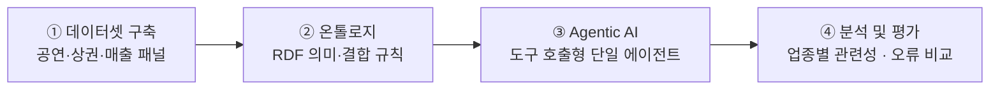
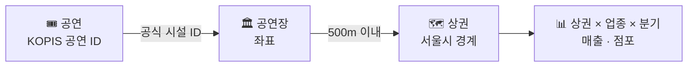

<div align="center">

# 🎭 공연 활동과 주변 외식업 매출의 관계 분석

### 온톨로지 기반 Agentic AI 분석 서비스 구축

학부 졸업프로젝트 · 지도교수 김태경


**[📑 보고서 모아보기](reports/index.html)** · **[📊 현재 분석 보고서](reports/main/revised_quarterly/report.html)** · **[▶️ 현재 분석 실행](notebooks/main/02_수정분석_실행.ipynb)** · **[📝 연구계획서](docs/proposals/졸업프로젝트_연구계획서_개정안.md)**

</div>

<br>

> 공연 활동이 많은 시기에 주변 음식점·카페의 **매출 규모**와 **시간대별 구성**이 어떻게 달라지는지 공개데이터로 분석한다. 그리고 데이터의 의미와 연결 규칙을 이해해 이 분석을 재현하는 **AI 서비스**를 만든다.

<table>
<tr>
<td align="center"><b>📍 지역</b><br>종로구 · 마포구</td>
<td align="center"><b>🍽️ 업종</b><br>외식업 10종</td>
<td align="center"><b>📅 기간</b><br>2023~2025년 12분기</td>
<td align="center"><b>🧩 분석 단위</b><br>상권 × 업종 × 분기</td>
</tr>
</table>

---

## 📚 목차

| | | |
|---|---|---|
| 🎯 [연구 주제](#topic) | 🗂️ [연구 범위와 데이터](#data) | 🔬 [연구 방법론](#method) |
| 📈 [진행 현황과 주요 결과](#results) | ⚠️ [연구의 한계](#limits) | 🧭 [앞으로의 진행 방향](#next) |
| 📁 [폴더 안내](#folders) | ▶️ [실행 방법](#run) | 📏 [작업 원칙](#rules) · 🔗 [참고자료](#refs) |

---

<a id="topic"></a>

## 🎯 연구 주제

### 배경과 동기

공연 관람 전후의 식사·음료 소비는 주변 음식점과 카페의 매출로 이어질 수 있다. 하지만 공연 자료(KOPIS)와 상권 자료(서울시)는 **시간 단위·공간 단위·측정 단위가 서로 달라서**, 그대로 연결하면 분석과 해석이 쉽게 틀어진다.

- 분기 자료를 월별이나 일별로 읽는 오류
- 미제공 매출을 0원으로 채우는 오류
- 같은 공연을 여러 상권에서 중복으로 세는 오류

김태경 교수님이 참여한 업종 간 공간적 관계 연구(고품질 음식점과 호텔 성과)에서 문제의식을 가져왔다. 이 연구는 그 관점을 **공연 → 외식업**으로 넓힌 사례이며, 원 논문의 자료나 식별 전략을 재현하지는 않는다.

### 연구 질문

| | 질문 | 성격 |
|:---:|---|:---:|
| **RQ1** · 매출 규모 | 같은 상권에서 공연 활동이 평소보다 많은 분기에 외식업 매출도 다른가? | 🔴 핵심 실증 |
| **RQ2** · 매출 구성 | 야간(21~24시) 매출은 공연 활동과 어떤 관계를 보이며, 업종별로 다른가? | 🔴 핵심 확장 |
| **RQ3** · 서비스 성능 | 온톨로지를 쓰면 AI의 단위·기간·공간 결합 오류가 줄어드는가? | 🔴 핵심 시스템 |
| **RQ4** · 추가 탐색 | 주말 비중, 장르, 시차, 공연 시간창에서 추가 패턴이 보이는가? | ⚪ 선택 |

> [!NOTE]
> 방향과 크기를 미리 정하지 않고 양측 검정과 신뢰구간으로 보고한다. 결과는 **관련성**으로 해석하며 인과효과로 단정하지 않는다.

### 연구의 구성



| 단계 | 산출물 |
|---|---|
| ① 데이터셋 구축 | 공연·공연장·상권·업종·분기별 매출을 연결한 패널 |
| ② 온톨로지 구축 | 기간·장소·업종·측정 단위·출처·허용되는 결합 규칙을 RDF로 정의 |
| ③ Agentic AI 구축 | 자연어 질문을 개념 조회 → 자료 결합 → 통계 도구 실행 → 근거 설명으로 바꾸는 단일 에이전트 |
| ④ 분석 및 평가 | 업종별 관련성 분석, 데이터 사전 기반 에이전트와 온톨로지 기반 에이전트의 오류·성공률 비교 |

---

<a id="data"></a>

## 🗂️ 연구 범위와 데이터

### 범위

| 항목 | 내용 |
|---|---|
| **지역** | 서울 종로구·마포구의 상권. 대상 구 밖이라도 상권 기준 500m 안의 공연장은 포함 |
| **업종** | 한식·중식·일식·양식, 제과점, 패스트푸드점, 치킨전문점, 분식전문점, 호프-간이주점, 커피-음료 |
| **기간** | 2023년 1분기 ~ 2025년 4분기 (12분기) |
| **분석 단위** | 상권 × 업종 × 분기 |

처음 계획한 두 업종(한식·커피)은 기준선 검증용으로 남겼다.

### 데이터 출처

| 자료 | 출처 | 사용 내용 |
|---|---|---|
| 💳 추정매출-상권 | 서울 열린데이터광장 OA-15572 | 분기 총매출, 6개 고정 시간대(00-06 · 06-11 · 11-14 · 14-17 · 17-21 · 21-24시) 매출 |
| 🏪 점포-상권 | 서울 열린데이터광장 OA-15577 | 일반·프랜차이즈·전체 점포 수 |
| 🗺️ 영역-상권 | 서울 열린데이터광장 OA-15560 | 상권 경계 (현재 버전) |
| 🎟️ 공연·공연시설 | KOPIS Open API | 공연 ID·기간·시설·공연 일정, 시설 좌표 |

### 고정된 수집 회차

| 자료 | 회차 ID | 내용 |
|---|---|---|
| KOPIS | `20261004_154020_1c7d3b` | 시설 상세 1,755개, 후보 공연 상세 13,727개. 서울 전체 공연 목록의 상세를 모두 수집했다는 뜻은 아니다. |
| 서울시 | `20261004_091155_b8dd0e` | 연도별 매출·점포와 현재 상권 경계 |

두 회차의 명세는 `metadata/main/`에 고정했다. 이후 다시 수집하더라도 이 명세는 자동으로 바뀌지 않는다.

---

<a id="method"></a>

## 🔬 연구 방법론

### 1️⃣ 데이터셋 구축



1. 원본 CSV·API 응답의 열 이름과 타입을 통일하고, 상권·업종·분기 키를 검사한다(일대일 결합 강제).
2. **공연 → 공연장:** 공식 시설 ID 연결과 시설명 임시 연결을 구분해 기록한다.
   - 공식 ID 연결은 13,727건, 시설명 잠정 연결은 16,320건이다.
   - 연구 범위 부분 그래프에는 공식 연결만 사용한다.
3. **공연장 → 상권:** 미터 단위 투영 좌표계로 거리를 계산하고, 500m 이내 관계를 모두 연결한다(최단 1개만 고르지 않음).
4. 분기별로 공연 노출을 집계하고 매출·점포와 결합한다.
5. 결측을 처리하고 표본 제외 사유를 보고한다.

> [!IMPORTANT]
> - **미제공 매출은 0원으로 채우지 않는다.** 실제로 0원이 제공된 값은 그대로 유지한다.
> - 분기 자료를 일별 자료로 해석하지 않는다.
> - 점포는 일반·프랜차이즈·전체로 구분한다. 일반점포가 0이고 프랜차이즈가 양수인 행은 오류가 아니다.
> - 매출 모집단이 확인되기 전에는 점포당 매출을 만들지 않는다.

### 2️⃣ 공연 활동(노출)의 측정

| 지표 | 정의 | 사용 단계 |
|---|---|---|
| 등록 공연 ID 수 | 분기와 공연 기간이 겹치는 공연 ID 수 | 기준선 분석 |
| **예정 시작회차** | 등록 기간에 상세정보의 정규 요일·시각을 반복해 만든 분기 내 시작 횟수 | ⭐ 수정 분석(현재 기본) |
| 예정 시간창 노출 | 시작시각 + 러닝타임으로 추정한 종료 후 0~3시간, 3~6시간 등이 매출 시간대와 겹치는 분량 | 시간창 탐색 |

예정 시작회차는 실제 회차나 관객 수가 아니다. 휴연, 과거 일정 변경, 공휴일 특수 일정은 반영하지 못한다.

### 3️⃣ 공간 연결

| 구분 | 기준 | 비교 사양 |
|---|---|---|
| 기준선 | 공연장 점과 상권 폴리곤의 **최단거리** 500m 이하 | 300m · 800m |
| ⭐ 수정 분석 | **상권 중심점**에서 500m 이내 | 기존 최단거리 연결 |

500m는 공연 노출을 상권에 부여하는 규칙이다. "공연장 500m 안 음식점만의 매출"을 뜻하지 않는다.

### 4️⃣ 통계 모형

**기본 고정효과 모형**

```text
Y(a,s,t) = α(a,s) + λ(s,t) + β_s · ln(1 + E(a,t)) + ε(a,s,t)
```

| 기호 | 의미 |
|---|---|
| a, s, t | 상권, 업종, 분기 |
| α(a,s) | 상권×업종 고정효과: 상권·업종의 변하지 않는 차이 |
| λ(s,t) | 업종×분기 고정효과: 업종별 공통 분기 변화 |
| β_s | 업종별 공연 활동 계수 |

| 항목 | 내용 |
|---|---|
| **결과변수** | 기준선은 ln(총매출)과 야간 비중(%). 수정 분석은 ln(1+총매출액)과 ln(1+21~24시 매출액)이며, 비중은 기술통계로만 쓴다. |
| **추론** | 상권 군집 표준오차(CR1)와 t(G−1) 분포. 신뢰구간은 개별 95% 구간 |
| **다중검정** | Benjamini–Hochberg(BH)와 Holm 보정. 미추정 결과는 p=1로 포함 |
| **효과 크기** | "1+노출이 2배일 때 매출+1의 조건부 기하평균 상대차이(%)" |

<details>
<summary><b>보조·민감도 분석과 사전 고정 원칙 펼쳐 보기</b></summary>

<br>

**보조·민감도 분석**

- 거리 300/500/800m, 균형표본, 일반점포·전체점포 통제
- within-between GEE와 고정효과 결과 비교
- 공연 시간창 모형: 6개 시간대 매출에 상권×업종×분기 고정효과를 더한 시간대 상대 패턴
- 공간 표준오차 민감도: 가우시안 커널, 대역폭 1km

**사전 고정 원칙**

- 수정 분석의 4개 사양(중심점 100%, 중심점 90%, 최단거리 100%, 같은 표본의 ID 수)은 회귀 결과를 보기 전에 [`metadata/main/revised_quarterly_plan.json`](metadata/main/revised_quarterly_plan.json)에 고정했다.
- p값에 따라 사양을 고르지 않는다.

</details>

### 5️⃣ 온톨로지와 분석 도구

- **RDF 지식그래프**([`07_RDF_지식그래프`](notebooks/main/analysis/07_RDF_지식그래프.ipynb))는 공연·시설·상권·업종·분기·지표의 관계와 단위·집계 규칙·출처를 RDFLib으로 표현한다.
  - 무결성 검사를 함께 수행한다.
  - 큰 집계 테이블은 CSV로 두고, 그래프는 의미와 관계를 관리한다.
- **분석 도구**([`08_분석도구`](notebooks/main/analysis/08_분석도구.ipynb))는 구조화된 요청으로 지표·집계·모형·품질을 조회하는 오프라인 도구 5종이다.
- **설계 원칙**
  - LLM이 숫자를 직접 만들지 않고, 계산은 검증된 도구가 맡는다.
  - "공연이 매출을 증가시킨다" 같은 인과관계를 온톨로지에 사실로 넣지 않는다.

---

<a id="results"></a>

## 📈 진행 현황과 주요 결과

### 진행 현황

| 단계 | 상태 |
|---|:---:|
| 원자료 수집(KOPIS·서울시)과 고정 | ✅ 완료 |
| 공연–시설–상권 연결, 외식업 10종 패널 | ✅ 완료 |
| 고정효과 기준선 분석, GEE 보조 분석 | ✅ 완료 |
| 공연 시간창 탐색 분석 | ✅ 완료 |
| 비유의성 원인 진단 | ✅ 완료 |
| 예정회차 기반 수정 분석 | ✅ 완료 |
| 폴더 구조 정리 (2026-10-06) | ✅ 완료 |
| RDF 부분 그래프와 오프라인 분석 도구 | 🟡 부분 구현 |
| 일자·시간대 정밀 매출 확보 | 🟡 검토 단계 (이용신청 전) |
| LLM 연결·자연어 처리·웹 시제품 | ⬜ 미착수 |
| 온톨로지 vs 데이터 사전 비교 평가 | ⬜ 미착수 |

RDF 부분 그래프에는 야간 비중·점포·회귀 결과가 아직 없다.

### 주요 결과

| | 분석 | 핵심 결과 | 보고서 |
|:---:|---|---|:---:|
| ① | **기준선**<br><sub>등록 공연 ID 수 · 최단거리 500m</sub> | 10개 업종 계수 전체에 대한 결합 검정이 총매출(p=0.79)과 야간 비중(Holm 보정 p=0.38) 모두 유의하지 않음. 보정 전 p<0.05는 야간 비중 2건(치킨 +1.10%p, 한식 −0.39%p)이었고, BH 보정 후 0건 | [📄](reports/main/baseline/report.html) |
| ② | **공연 시간창**<br><sub>종료 후 0~3시간 등 4개 창</sub> | 종료 후 0~3시간 공통 기울기 −0.040, 95% CI [−0.105, +0.024]. 업종별 40개 검정은 보정 전에도 유의한 결과 없음 | [📄](reports/main/time_windows/공연시간창_분석보고서.html) |
| ③ | **비유의성 진단** | 수집 실패나 계산 오류는 아님(기존 64개 결과 재현, 최대 차이 약 2×10⁻¹⁶). 측정 범위·변동·표본·노출 중첩의 구조적 원인 확인 | [📄](reports/main/null_diagnostics/report.html) |
| ④ | **수정 분석** ⭐<br><sub>예정 시작회차 · 중심점 500m</sub> | 사전 고정한 80개 결과 모두 보정 전부터 p≥0.05. 공연 밀집 상권이 표본에서 크게 빠짐 | [📄](reports/main/revised_quarterly/report.html) |
| ⑤ | **예비 실험**<br><sub>본 연구에 반영하지 않음</sub> | 실제자료 사후 탐색 580개 검정 중 보정 전 p<0.05는 16개, 전체 BH 보정 후 0개 | [📄](reports/experiments/report.html) |

<details>
<summary><b>③ 비유의성 진단에서 확인한 구조적 원인</b></summary>

<br>

- **측정이 연구 질문보다 넓다:** 분기 집계, 등록 공연 ID 수 사용, 관객 수 미관측
- **비교에 쓸 수 있는 변동이 적다:** 고정효과로 공통 변화를 제거하면 노출 변동이 줄어들고, 일부 업종은 정보가 소수 상권에 몰려 있다.
- **업종별 표본이 다르다:** 매출 미제공 여부에 따라 업종마다 관측되는 상권이 다르다.
- **노출이 겹친다:** 공연 ID의 99%가 둘 이상의 상권에 연결된다.

</details>

<details open>
<summary><b>④ 수정 분석 핵심 수치</b></summary>

<br>

| 항목 | 값 |
|---|---|
| 주 표본 | 5,015행 · 114개 상권 · 10개 업종 |
| 사전 고정 결과 | 80개 (4개 사양 × 2개 결과 × 10개 업종) |
| 보정 전 p<0.05 | 0개 |
| 한식 총매출 | **+0.32%** [−2.52%, +3.24%] — 0에 가까운 좁은 범위 |
| 패스트푸드 총매출 | **+5.18%** [−3.61%, +14.77%] — 상당한 양의 관계도 배제하지 못함 |
| 표본 대표성 | 대학로(혜화역)·홍대입구역(홍대)이 기본 표본에서 빠짐. 분기 후보 공연 100개 이상인 관측은 2.84%만 남음 |

</details>

<details>
<summary><b>⑤ 합성 효과 주입 모의실험</b></summary>

<br>

10개 업종에 같은 효과가 있고 공간 상관이 없다는 가정에서 계산했다. 실제 효과가 5%라면 BH 보정 후 검출률은 다음과 같다.

| 업종 | 검출률 |
|---|:---:|
| 한식 | 약 87% |
| 커피 | 약 45% |
| 패스트푸드 | 약 18% |

이 결과는 실제 효과의 존재 확률이 아니다. 업종별 정밀도의 차이를 보여 주는 참고자료다.

</details>

> [!IMPORTANT]
> **결론의 표현:** 유의하지 않은 결과는 "공연의 소비 효과가 없다"는 증거가 아니다. 이 결과가 말해 주는 것은 정해진 공개자료와 표본에서 **뚜렷한 분기 단위 관련성을 확인하지 못했다**는 점이다. 지표 정의, 공간 연결, 일정 가용성에 따라 표본과 결과가 달라진다는 점도 함께 연구 결과로 제시한다.

---

<a id="limits"></a>

## ⚠️ 연구의 한계

| 구분 | 내용 |
|---|---|
| **노출 측정** | 예정회차와 공연 ID 수는 실제 상연 횟수나 관객 수가 아니다. 과거 일정 변경과 휴연은 반영하지 못한다. |
| **시간 해상도** | 매출은 분기 합계다. 공연 직후 몇 시간의 소비를 직접 관측하지 못한다. |
| **공간** | 현재 시설 좌표와 현재 상권 경계를 과거 분기에 적용했다. 상권 전체 매출에는 공연장에서 먼 곳의 소비도 섞여 있고, 여러 상권이 같은 공연을 공유한다. |
| **표본** | 작은 상권·업종에서 매출이 선택적으로 미제공된다. 업종별로 관측 상권이 다르고, 10개 업종이 모두 관측되는 공통표본은 13개 상권뿐이다. 공연 밀집 상권이 제외됐다. |
| **식별** | 고정효과로도 지역별로 시간에 따라 변하는 요인(관광, 유동인구, 날씨, 다른 행사)은 제거하지 못한다. 따라서 결과는 인과효과가 아니다. |

---

<a id="next"></a>

## 🧭 앞으로의 진행 방향

남은 일은 **(A) 실증분석 보강**과 **(B) 원래 계획의 시스템 부분(온톨로지·AI·평가) 완성**으로 나뉜다.

> [!TIP]
> **졸업프로젝트의 최소 완성 기준:** 결합 데이터셋 · 문서화한 의미·검증 규칙 · 재현 가능한 분석 · 작동하는 단일 에이전트 · 비교 평가.
> 통계적 유의성이나 온톨로지의 우월성은 완성 기준이 아니다.

### A. 실증분석 보강

- [ ] **공연 밀집 상권의 일정 검증**
  - 대학로·홍대처럼 기본 표본에서 빠진 핵심 상권의 후보 공연부터 원문 일정을 확인한다.
  - 실제 날짜·회차·휴연 이력을 대조한다(점검 목록: [`results/experiments/06_core_verification_priority.csv`](results/experiments/06_core_verification_priority.csv)).
  - 그다음 이 상권들을 넣었을 때 결과가 유지되는지 확인한다.
- [ ] **노출 지표 개선**
  - KOPIS 통계 API(상연 횟수, 티켓 판매 수)를 시험 조회한다.
  - 기간 기준(공연일/예매일)과 키 연결을 검증한 뒤 예정회차와 비교한다.
  - 현재 좌석 수는 과거 좌석이나 관객 수로 대체하지 않는다.
- [ ] **정밀 매출 자료 확보**
  - 서울시 빅데이터캠퍼스 B079(일자 × 6개 시간대, 가맹점 격자)의 이용신청과 방문 일정을 확인한다.
  - 신청서 초안은 [`docs/data_requests/`](docs/data_requests/)에 있고, 아직 제출하지 않았다. 검토 결과는 [자료 확보 검토 보고서](reports/main/data_access/일자시간대매출_자료확보_검토.html)에 있다.
  - 확보 전까지는 새로운 시간창을 반복 탐색하지 않는다.
  - 6구간 자료로도 정확한 "종료 후 3시간" 매출은 복원할 수 없다는 점을 전제로 설계한다.
- [ ] **검정력 기반 설계**
  - 의미 있는 효과 크기를 먼저 정하고, 그 크기를 검출하는 데 필요한 표본·시간창을 모의실험으로 정한다.
  - 충분히 좁은 구간이 0 주변에 남으면 그것도 연구 결과로 보고한다.

### B. 온톨로지 · Agentic AI · 평가

- [ ] **온톨로지 확장**
  - 야간 매출, 점포(일반/프랜차이즈/전체), 회귀 실행 기록(AnalysisRun)을 RDF에 추가한다.
  - 단위·기간·공간 결합 규칙을 SHACL 또는 그에 준하는 결정적 검증 함수로 검사한다.
- [ ] **에이전트 구현**
  - 도구 호출을 지원하는 LLM 1종을 기존 오프라인 도구 5종에 연결한다.
  - 단일 에이전트로 개념 해석 → 패널 조회 → 허용된 모형 실행 → 근거 카드 생성을 수행한다.
  - 지원하지 않는 질문(공연 직후 3일 매출, 개별 점포 매출 등)은 숫자를 만들지 않고 거절한다.
- [ ] **웹 시제품**
  - 질문 입력, 분석 조건, 결과 그래프·표, 근거(출처·실행 ID) 화면으로 구성한 간단한 Python 웹 UI를 만든다.
- [ ] **비교 평가**
  - 데이터 사전 기반 에이전트와 온톨로지 기반 에이전트를 같은 LLM·데이터·도구·검증 기능으로 비교한다.
  - 평가 30문항(단순 조회 6, 다중 결합 8, 회귀·사양 비교 8, 답할 수 없는 요청 8) × 2조건 × 3회로 실행한다.
  - 지표는 과제 성공률, 수치 정확도, 오류 유형(월·분기 혼동, 중복 집계, 단위 혼동), 지원 불가 판단, 비용이다.

### C. 마무리

- [ ] 졸업논문을 작성하고, 새 환경에서 고정 데이터로 핵심 결과를 다시 실행할 수 있는지 확인한다.
- [ ] 시연을 준비한다.

일정이 부족하면 선택 분석 → 시설별 티켓 지표 → 시차 분석 → 화면 부가 기능 순서로 줄인다. 데이터 품질 검사, 기본 분석, 비교 평가, 출처 기록은 줄이지 않는다.

---

<a id="folders"></a>

## 📁 폴더 안내

**읽는 보고서, 실행 코드, 분석 데이터, 계산 결과를 용도별로 분리했다.** 각 폴더에는 본 분석(`main`), 예비 실험(`experiments`), 이전 결과(`legacy`)가 나뉘어 있다.

### 자주 여는 자료

| | 자료 | 위치 |
|:---:|---|---|
| 📑 | 보고서 모아보기 | [`reports/index.html`](reports/index.html) |
| 📊 | 현재 분기 분석 보고서 | [`reports/main/revised_quarterly/report.html`](reports/main/revised_quarterly/report.html) |
| 🧪 | Preliminary 실험 보고서 | [`reports/experiments/report.html`](reports/experiments/report.html) |
| ▶️ | 현재 분석 실행 | [`notebooks/main/02_수정분석_실행.ipynb`](notebooks/main/02_수정분석_실행.ipynb) |
| ▶️ | 실험 전체 실행 | [`notebooks/experiments/00_전체실행.ipynb`](notebooks/experiments/00_전체실행.ipynb) |
| 📝 | 연구계획서 | [`docs/proposals/졸업프로젝트_연구계획서_개정안.md`](docs/proposals/졸업프로젝트_연구계획서_개정안.md) |

### 폴더별 내용

| 폴더 | 담는 내용 |
|---|---|
| 📑 [`reports/`](reports/README.md) | 사람이 읽는 HTML 보고서·노트북 출력. CSV와 실행 로그는 넣지 않음 |
| 📓 [`notebooks/`](notebooks/README.md) | 본 분석·보고서 생성·실험·관리용 Jupyter Notebook |
| 💾 `data/` | 원자료, 정리된 입력, 분석용 패널·지식그래프 |
| 📊 [`results/`](results/README.md) | 회귀 계수표, 진단표, 그림, 검증·실행 기록, 보고서 생성용 자료 |
| 📥 [`collection/`](collection/README.md) | KOPIS·서울시 자료 수집 노트북과 실행 도구 |
| 🧾 [`metadata/`](metadata/README.md) | 고정 입력 명세, 분석 계획, 출처 및 폴더 이동 기록 |
| 📚 [`docs/`](docs/README.md) | 선행논문·연구계획서·자료 문의 초안 |
| 🗄️ [`archive/`](archive/README.md) | 이전 작업과 정리 전 복구용 보관본 |
| 🧹 `tmp/` | 재생성 가능한 실행 중간 작업물 |

<details>
<summary><b>폴더 트리 펼쳐 보기</b></summary>

<br>

```text
graduation-project/
├─ reports/                  읽는 보고서 (HTML)
│  ├─ index.html             보고서 모아보기
│  ├─ main/                  revised_quarterly · baseline · time_windows · null_diagnostics · data_access
│  ├─ experiments/           예비 실험 보고서
│  ├─ audits/                데이터·방법 검토 기록
│  └─ legacy/                이전 버전 읽기본
├─ notebooks/
│  ├─ main/                  00·01·02 실행 노트북
│  │  ├─ analysis/           분석 노트북 01~13
│  │  └─ reporting/          근거 정리·진단·보고서 생성
│  ├─ experiments/           예비 실험
│  └─ maintenance/           폴더 구조·경로·무결성 검증
├─ data/
│  ├─ raw/                   원자료 (수정 금지)
│  └─ analysis/              final · experiments · baseline_two_industry · legacy
├─ results/                  main · experiments · collection · audits · legacy
├─ collection/               수집 노트북, KOPIS 수집기
├─ metadata/                 main · experiments · collection · organization
├─ docs/                     proposals · references · data_requests
└─ archive/                  이전 작업 보관본 (수정 금지)
```

</details>

> [!NOTE]
> - `data/analysis/final`은 고정 입력과 재현성을 위해 기존 이름을 유지한다.
> - CSV가 필요하면 `results/`의 주제별 안내를 본다.
> - 2026년 10월 6일의 경로 이동 내역은 [`metadata/organization/20261006_moves.json`](metadata/organization/20261006_moves.json)에 보존했다. 정리 전 코드·명세·결과는 `archive/20261006_before_organization.zip`에서 복구할 수 있다.

---

<a id="run"></a>

## ▶️ 실행 방법

**수집 없이 분석할 수 있다.** 분석 노트북은 네트워크 요청이나 인증키 없이 로컬 고정 입력만 읽는다.

1. **환경 준비:** Python 3.12 환경을 만들고 `pip install -r requirements.txt`로 패키지를 설치한다.
2. **현재 분석:** [`notebooks/main/02_수정분석_실행.ipynb`](notebooks/main/02_수정분석_실행.ipynb)를 위에서 아래로 실행한다.
   - 실행 순서: `12` 데이터셋 → `13` 분석 → `reporting/09` 표본 진단 → `reporting/08` 보고서
3. **기초 입력·기준선 재현:** [`notebooks/main/00_전체실행.ipynb`](notebooks/main/00_전체실행.ipynb)를 실행한다.
4. **공연 시간창 분석:** [`notebooks/main/01_시간대확장_실행.ipynb`](notebooks/main/01_시간대확장_실행.ipynb)를 실행한다.
5. **수집(선택):** [`collection/`](collection/README.md)에서 따로 실행한다. 인증키는 환경변수나 프로젝트 외부 설정에서만 읽는다.

자세한 순서는 [본 분석 안내](notebooks/main/README.md)와 [수집 안내](collection/README.md)에 있다. 일부 폴더만 복사하면 원자료가 없어 실행되지 않으므로, 다른 환경으로 옮길 때는 프로젝트 폴더 구조 전체를 유지한다.

---

<a id="rules"></a>

## 📏 작업 원칙

자세한 규칙은 [AGENTS.md](AGENTS.md)에 있다.

- 📓 분석·전처리·시각화·수집 코드는 **Jupyter Notebook**으로 작성한다. 한국어 설명 → 코드 → 표·그림 → 해석 순서로 쓰고, 새 커널에서 위에서 아래로 실행할 수 있어야 한다.
- 🔒 `data/raw/`, `archive/`, 이전 기준선 결과는 **읽기 전용**이다. 새 결과는 별도 경로에 저장한다.
- 📑 `reports/`에는 읽는 문서만, CSV·JSON·로그·그림 원본은 `results/`에 둔다.
- 🚫 미제공 매출을 0원으로 채우지 않는다. 분기 자료를 일별로 해석하지 않는다.
- 🔗 공식 ID 연결과 시설명 임시 연결을 구분한다. 좌표·경계의 한계를 결과에 표시한다.
- 🔑 인증키는 노트북 소스·출력·공유 파일에 넣지 않는다.

---

<a id="refs"></a>

## 🔗 참고자료

**선행연구**

- Mun, S. G., Woo, L., Kim, T., & Shin, S. (2026). Can nearby high-quality restaurants increase other tourism firms' performance? Evidence from hotels. *International Journal of Hospitality Management*, 132, 104356.

**데이터**

- 서울시 상권분석서비스: [추정매출-상권 OA-15572](https://data.seoul.go.kr/dataList/OA-15572/A/1/datasetView.do) · [점포-상권 OA-15577](https://data.seoul.go.kr/dataList/OA-15577/S/1/datasetView.do) · [영역-상권 OA-15560](https://data.seoul.go.kr/dataList/OA-15560/S/1/datasetView.do)
- [KOPIS 공연예술통합전산망](https://kopis.or.kr/por/main/main.do) · [Open API 개발가이드](https://kopis.or.kr/upload/openApi/%EA%B3%B5%EC%97%B0%EC%98%88%EC%88%A0%ED%86%B5%ED%95%A9%EC%A0%84%EC%82%B0%EB%A7%9DOpenAPI%EA%B0%9C%EB%B0%9C%EA%B0%80%EC%9D%B4%EB%93%9C.pdf)

**기술 표준**

- W3C [RDF 1.1](https://www.w3.org/TR/rdf11-concepts/) · [SHACL](https://www.w3.org/TR/shacl/) · [PROV-O](https://www.w3.org/TR/prov-o/)

**연구계획서 원문**

- [연구계획서](docs/proposals/졸업프로젝트_연구계획서_개정안.md) · [상세 연구계획서](docs/proposals/졸업프로젝트_상세연구계획서_개정안.md)

<br>

<div align="center">

<sub>공개데이터 기반 학부 졸업프로젝트 · 결과는 관련성 분석이며 인과효과를 주장하지 않는다.</sub>

</div>
